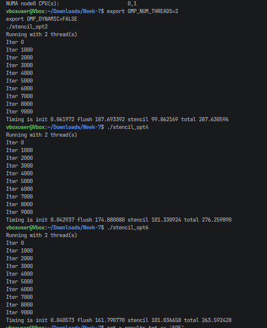

# 2D Stencil Computation – Optimization Assignment

## 1. Project Overview

We worked on a 2D stencil computation and its optimization. All three programs perform the same computation using a **2002 × 2002 grid** and **10,000 iterations**.

The program calculates each cell using its own value and the values of its four neighboring cells. It also records execution times for initialization, cache flushing, stencil calculations, and total execution.

The main difference between the three implementations is how they distribute work between CPU threads.

## 2. Implementation Differences

### Original – `stencil_opt2.c`

The original implementation creates separate OpenMP parallel regions for each process, including initialization, cache flushing, and stencil calculations. Repeatedly creating parallel regions introduces additional overhead.

### First Optimization – `stencil_opt4.c`

The first optimization uses one persistent parallel region to distribute work between threads. It uses OpenMP work-sharing to divide loop iterations and the `nowait` clause to avoid waiting at the end of the cache-flush loop.

### Second Optimization – `stencil_opt6.c`

The second optimization also uses one persistent parallel region, but manually distributes work between threads using their thread IDs. It uses explicit barriers to synchronize threads.

## 3. Hardware and Configuration

| Component | Configuration |
|---|---|
| CPU | Intel Core i7-4770 @ 3.40 GHz |
| CPUs available to VM | 2 |
| OpenMP threads | 2 |
| Grid size | 2002 × 2002 |
| Iterations | 10,000 |
| Compiler | GCC |
| Optimization | `-O2` |

## 4. Benchmark Results

All three implementations were executed using the same hardware configuration and two OpenMP threads.

| Metric | Original (`opt2`) | First OPT (`opt4`) | Second OPT (`opt6`) |
|---|---:|---:|---:|
| Initialization (s) | 0.061972 | 0.042937 | 0.040573 |
| Cache flush (s) | 187.693392 | 174.880080 | 161.790770 |
| Stencil calculation (s) | 99.862169 | 101.330924 | 101.036658 |
| **Total execution (s)** | **287.630596** | **276.259890** | **263.592428** |

### Performance Comparison

- First optimization (`opt4`) is approximately **3.95% faster** than the original.
- Second optimization (`opt6`) is approximately **8.36% faster** than the original.
- The fastest implementation is `stencil_opt6.c`.

The biggest improvement is visible in cache-flush time and initialization time. Stencil calculation times remain relatively similar across all three implementations.

## 5. Assignment Questions and Answers

### 1. How many threads did the CPU use to execute the code?

The virtual machine exposed two CPUs, so the programs were executed using **2 OpenMP threads**.

The thread configuration was set using:

```bash
export OMP_NUM_THREADS=2
export OMP_DYNAMIC=FALSE
```

### 2. What parts of the code were improved and what strategies were used?

The main improvements were related to parallel-region management and work distribution.

- The original implementation repeatedly creates parallel regions.
- The first optimization keeps one parallel region active and uses OpenMP work-sharing.
- The second optimization keeps one parallel region active and manually divides work between threads using thread IDs.
- Explicit synchronization barriers are used in the second optimization to coordinate threads.

These strategies reduce parallelization overhead and improve execution time.

### 3. What is the difference between explicit and implicit barriers? Were they used in any examples?

An **implicit barrier** is automatically created at the end of certain OpenMP constructs, such as `omp for`. Threads wait until all participating threads reach that point before continuing. The `nowait` clause removes this automatic waiting point.

An **explicit barrier** is manually added by the programmer using:

```c
#pragma omp barrier
```

It forces all threads to wait until every thread reaches that point.

In our implementations:

- **Original (`opt2`):** Uses implicit barriers at the ends of its parallel work-sharing loops.
- **First optimization (`opt4`):** Uses implicit barriers, except after the cache-flush loop, where `nowait` removes the barrier. It does not use explicit barriers.
- **Second optimization (`opt6`):** Uses explicit barriers after initialization, stencil calculations, and pointer swapping.

## 6. Conclusion

The benchmark results show that both optimized implementations achieved better total execution times than the original implementation.

The second optimization, `stencil_opt6.c`, achieved the best result, reducing total execution time by approximately **8.36%** compared with the original.

This demonstrates how keeping a parallel region active, distributing work efficiently, and managing thread synchronization can improve parallel program performance.

## 7. Terminal Screenshot

