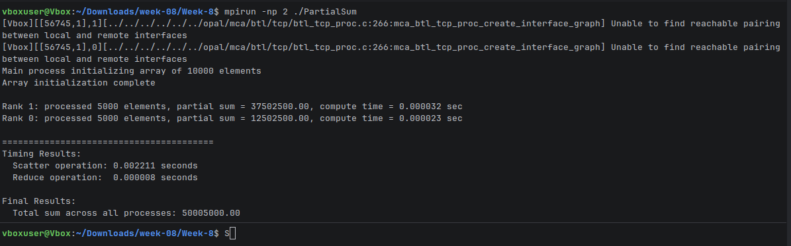
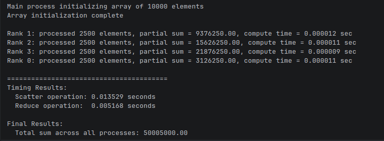
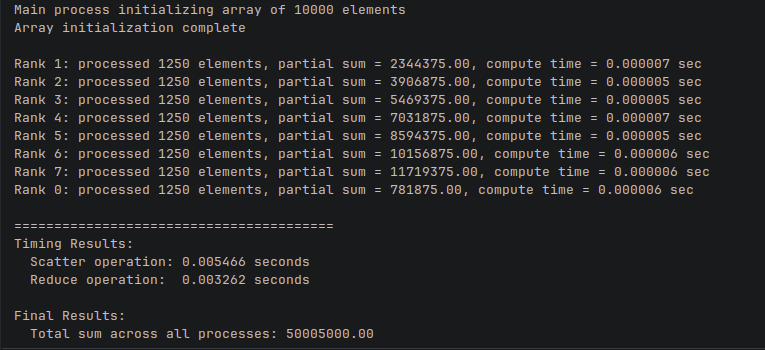

# Week 8 – MPI Collective Communications

## Introduction

This assignment focuses on using MPI collective communication functions to calculate the sum of an array in parallel. The array contains 10,000 elements and is initialized by the main process (rank 0).

The array is divided equally between the available processes. Each process receives its own portion of the array, calculates a partial sum, and then the partial sums are combined to calculate the final result.

The main goal is to understand how collective communication functions are used to distribute data and combine results between multiple processes.

---

## Implementation

### 1. Calculating the size and bounds for each process

First, the array size is divided by the number of processes to determine how many elements each process will receive. The starting and ending indexes are also calculated based on the process rank.

```c
int nsize = ncells / nprocs;
int start_index = rank * nsize;
int end_index = start_index + nsize - 1;
```

Since the array contains 10,000 elements, each process receives an equal portion depending on the number of processes used. For example, when running with 4 processes, each process receives 2,500 elements.

### 2. MPI_Allgather

```c
MPI_Allgather(&nsize, 1, MPI_INT, nsizes, 1, MPI_INT, comm);
```

MPI_Allgather is used to collect the number of elements each process will receive. Each process sends its local `nsize`, and the values are gathered into the `nsizes` array.

Unlike some other collective operations, Allgather sends the collected information to every process, meaning every process has access to the sizes of all other processes.

### 3. Allocating the local array

```c
double *a_local = (double *)malloc(nsize * sizeof(double));
```

Each process allocates memory for its own local array. This array is used to store the portion of the global array that will be received from the main process.

### 4. MPI_Scatterv

```c
MPI_Scatterv(a_global, nsizes, offsets, MPI_DOUBLE,
              a_local, nsize, MPI_DOUBLE, 0, comm);
```

MPI_Scatterv distributes the global array from rank 0 to all processes. Each process receives its assigned portion of the array and stores it in its local array.

The `nsizes` array specifies how many elements each process receives, while `offsets` specifies where each portion begins in the global array. Scatterv is used instead of Scatter because it allows different amounts of data to be sent to each process, although in this assignment the array is divided equally.

### 5. Calculating the partial sums

```c
double local_sum = 0.0;
for (int i = 0; i < nsize; i++) {
    local_sum += a_local[i];
}
```

After receiving its portion of the array, each process calculates its own partial sum. This calculation is performed independently, meaning all processes can work on their assigned data without needing to communicate during the summation.

### 6. MPI_Reduce

```c
MPI_Reduce(&local_sum, &total_sum, 1, MPI_DOUBLE,
            MPI_SUM, 0, comm);
```

MPI_Reduce is used to combine the partial sums from all processes into one final sum. The MPI_SUM operation adds all the local sums together, and the result is stored on rank 0.

Only the main process receives the final result and prints the total sum.

### 7. Memory deallocation

```c
if (rank == 0) {
    free(a_global);
}

free(a_local);
```

The global array is only allocated on rank 0, so it is only freed by that process. Each process has its own local array, which is why every process frees its own `a_local` allocation before finishing.

---

## Results

The program was tested using 2, 4, and 8 processes. In every run, the final sum was the same, which confirms that the array was distributed and processed correctly.

The expected total sum of the numbers from 1 to 10,000 is:

**50,005,000**

### Run with 2 processes

Each process receives 5,000 elements.



### Run with 4 processes

Each process receives 2,500 elements.



### Run with 8 processes

Each process receives 1,250 elements.



---

## Conclusion

The assignment demonstrates how MPI collective communication functions can be used to divide work between multiple processes and combine their results. The array is distributed using MPI_Scatterv, each process calculates its own partial sum, and MPI_Reduce is used to calculate the final sum.

All three runs produced the correct total of 50,005,000. Increasing the number of processes reduced the amount of data each process had to calculate, but it also introduced additional communication overhead. Because of this, using more processes does not necessarily mean the program will run faster, especially when working with a relatively small array and a virtual machine.

Overall, this assignment helped me understand how collective MPI communication works and how data can be distributed and combined between processes.